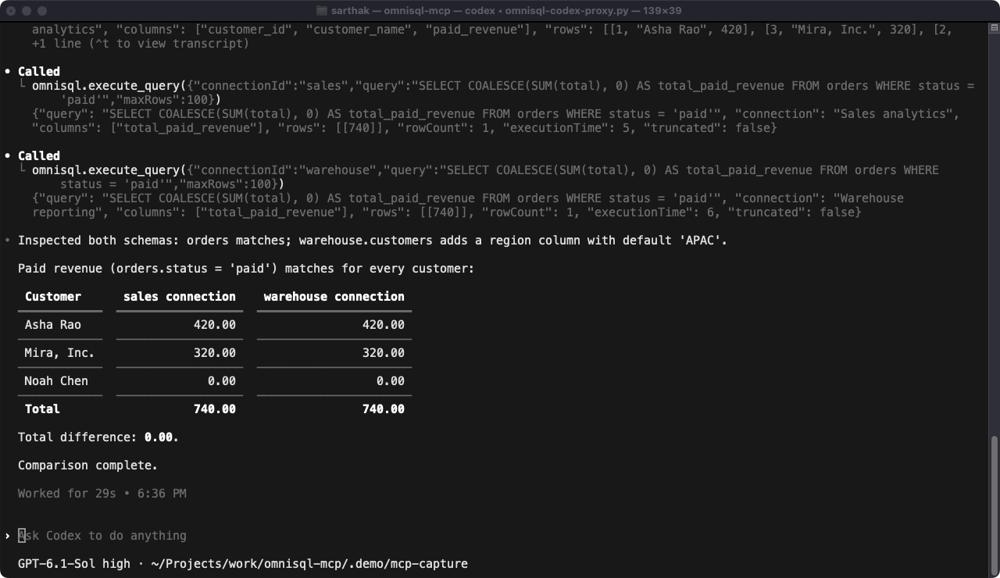

<p align="center">
  
</p>

<p align="center">
  Give Claude Code, Codex, and OpenCode access to the databases you already use.<br>
  Reuse saved DBeaver connections, query with native drivers, and keep control over access.
</p>

<p align="center">
  <a href="https://www.npmjs.com/package/omnisql-mcp"></a>
  <a href="https://github.com/srthkdev/omnisql-mcp/actions/workflows/ci.yml"></a>
  <a href="https://github.com/srthkdev/omnisql-mcp/stargazers"></a>
  <a href="LICENSE"></a>
</p>

<p align="center">
  <a href="#quick-setup">quick setup</a> ·
  <a href="#what-you-can-do">features</a> ·
  <a href="#try-the-demo">demo</a> ·
  <a href="https://srthkdev.github.io/omnisql-mcp/">docs</a> ·
  <a href="CHANGELOG.md">releases</a>
</p>

<p align="center"><a href="assets/codex-session.mp4"></a></p>

<p align="center">Captured from the real Codex CLI window against synthetic SQLite instances. <a href="assets/codex-session.mp4">Watch the recording</a> · <a href="assets/codex-session.gif">GIF preview</a>.</p>

## What you can do

| Capability | How it helps |
|---|---|
| **Reuse saved connections** | Read database and SSH settings from DBeaver-compatible workspaces, including custom projects. |
| **Query across engines** | PostgreSQL, MySQL/MariaDB, SQLite, SQL Server, Oracle, DuckDB, and ClickHouse. |
| **Choose another database** | Discover databases and select one at call time, using the same saved server credentials. |
| **Understand your data** | Browse tables, inspect columns, explain queries, export CSV/JSON, and compare schemas. |
| **Control access** | Choose read-only mode, restrict connections, or disable tools. |
| **Set up your client** | One guided command for Claude Code, Codex, and OpenCode. |

## Database Support

**Supported execution paths**:
- PostgreSQL (via `pg`)
- MySQL / MariaDB (via `mysql2`)
- SQL Server / MSSQL (via `mssql`)
- SQLite (via `sqlite3` CLI)
- ClickHouse (HTTP/HTTPS with keep-alive and zstd/gzip; no external client)
- DuckDB (via DuckDB CLI 1.5.6+; existing local files, locked safe mode, exact numeric output)
- Oracle (via `oracledb`)

**Postgres-compatible** (routed through `pg` driver automatically):
- CockroachDB, TimescaleDB, Amazon Redshift, YugabyteDB, AlloyDB, Supabase, Neon, Citus

**Other databases**: Unsupported drivers return an explicit error. External GUI/CLI query fallback has been removed so access and output policies remain enforceable.

DuckDB uses an installed CLI so its native binary stays out of the npm package. Install it with `brew install duckdb` on macOS, or use the [official downloads](https://duckdb.org/install/). Set `OMNISQL_DUCKDB_CLI` if the executable is outside your MCP client's PATH. See [database support](https://srthkdev.github.io/omnisql-mcp/guides/databases/) for configuration and limits.

**Custom drivers** wrapping any of the above are detected automatically — see [Custom and IAM-Authenticated Drivers](#custom-and-iam-authenticated-drivers).

## Requirements

- Bun 1.4.3+ or Node.js 22.15+
- A local DB client (DBeaver-compatible) with at least one configured connection

## Quick setup

Run the guided installer, choose Claude Code, Codex, or OpenCode, and OmniSQL adds itself to that client's MCP configuration:

```bash
npx -y omnisql-mcp@latest install
```

The installer detects installed clients, asks for your DBeaver workspace, lets you choose read-only access and a connection allowlist, then registers the server. Database and SSH credentials come from your saved workspace; no OmniSQL API key is needed. Start a new client session after setup.

To add it to a specific client directly:

```bash
npx -y omnisql-mcp@latest install claude
npx -y omnisql-mcp@latest install codex
npx -y omnisql-mcp@latest install opencode
```

Add `--read-only` to register with writes disabled, or `--dry-run` to print the registration command. Direct setup uses the default workspace and the server's normal read/write settings unless you pass `--read-only`.

### Native client commands

You can also register the server using your client's own CLI:

```bash
# Claude Code — available across projects
claude mcp add --transport stdio --scope user omnisql -- npx -y omnisql-mcp@latest

# Codex
codex mcp add omnisql -- npx -y omnisql-mcp@latest

# OpenCode v2 — available across projects
opencode mcp add omnisql --global -- npx -y omnisql-mcp@latest
```

These follow the [Claude Code](https://code.claude.com/docs/en/mcp), [Codex](https://developers.openai.com/codex/mcp), and [OpenCode v2](https://opencode.ai/v2/docs/mcp-servers) registration commands. OpenCode v1 users can add a local server through their MCP settings.

### Claude Desktop and Cursor

Add the following MCP entry to Claude Desktop's `claude_desktop_config.json`, or Cursor's `mcp.json`:

```json
{
  "mcpServers": {
    "omnisql": {
      "command": "npx",
      "args": ["-y", "omnisql-mcp@latest"]
    }
  }
}
```

On Windows, use `"command": "cmd"` and `"args": ["/c", "npx", "-y", "omnisql-mcp@latest"]` when your client cannot launch `npx` directly.

### Standalone install (macOS / Linux)

For a local executable, including machines without Node.js:

```bash
curl -fsSL https://srthkdev.github.io/omnisql-mcp/install.sh | bash
```

Installs under `~/.local/share/omnisql-mcp` with a launcher at `~/.local/bin/omnisql-mcp`, without sudo. If Bun 1.4.3+ is unavailable, it downloads a private Bun runtime and verifies its SHA-256 checksum. Use the printed absolute launcher path as your MCP client's command. Run the installer again to upgrade; append `bash -s -- 2.2.0` in place of `bash` to pin a version. `OMNISQL_INSTALL_DIR` and `OMNISQL_BIN_DIR` choose other directories.

## One server, many instances

Register OmniSQL once. Select `connectionId` in each tool call; select `database` to switch databases on PostgreSQL, MySQL/MariaDB, SQL Server, or ClickHouse. Each instance can have its own read-only setting, table policy, credentials, timeout, row/byte limits, and pool size.

Set `OMNISQL_CONFIG_FILE` to your JSON configuration, or reuse discovered workspace connections. Explicit connections default to read-only. See the [multi-instance configuration guide](https://srthkdev.github.io/omnisql-mcp/docs/getting-started/configuration/) and [access policies](https://srthkdev.github.io/omnisql-mcp/docs/guides/access/).

Large results use private, expiring handles with row and column pagination. Long cells and large exports can be read in bounded chunks. See [result paging](https://srthkdev.github.io/omnisql-mcp/docs/guides/usage-examples/#read-a-large-result-in-pages).

## Configuration

### Environment Variables

| Variable | Description | Default |
|----------|-------------|---------|
| `OMNISQL_CONFIG_FILE` | JSON configuration for multiple database instances and their settings | Unset |
| `OMNISQL_POLICY_FILE` | Additional schema, table, function, and database access rules | Unset |
| `OMNISQL_WORKSPACE` | Path to local DB client workspace directory | OS default |
| `OMNISQL_PROJECT` | Restrict discovery to one DB client project/workspace folder | All projects |
| `OMNISQL_TIMEOUT` | Query timeout (ms) | `30000` |
| `OMNISQL_DEBUG` | Enable debug logging | `false` |
| `OMNISQL_UPDATE_NOTIFIER` | Check npm for updates and show notices on stderr | `true` |
| `OMNISQL_READ_ONLY` | Disable all write operations | `false` |
| `OMNISQL_ALLOWED_CONNECTIONS` | Comma-separated whitelist of connection IDs or names | All |
| `OMNISQL_DISABLED_TOOLS` | Comma-separated tools to disable | None |
| `OMNISQL_POOL_MIN` | Minimum connections per pool | `0` |
| `OMNISQL_POOL_MAX` | Maximum connections per pool | `4` |
| `OMNISQL_POOL_IDLE_TIMEOUT` | Idle connection timeout (ms) | `30000` |
| `OMNISQL_POOL_ACQUIRE_TIMEOUT` | Connection acquire timeout (ms) | `10000` |
| `OMNISQL_AWS_CLI_PATH` | Path to the AWS CLI (used for RDS IAM authentication) | `aws` |
| `OMNISQL_IAM_TOKEN_TIMEOUT` | Timeout for minting an RDS IAM auth token (ms) | `20000` |
| `OMNISQL_SSH_KNOWN_HOSTS` | known_hosts file used to verify SSH tunnel hosts | `~/.ssh/known_hosts` |
| `OMNISQL_SSH_STRICT_HOST_KEY` | Refuse SSH tunnel hosts with no `known_hosts` entry | `false` |

### Read-Only Mode

Blocks all write operations. The `execute_query` tool only allows SELECT, EXPLAIN, SHOW, and DESCRIBE statements. Transaction tools are disabled entirely.

```json
{
  "mcpServers": {
    "omnisql": {
      "command": "npx",
      "args": ["-y", "omnisql-mcp@latest"],
      "env": {
        "OMNISQL_READ_ONLY": "true"
      }
    }
  }
}
```

### Connection Whitelist

Restrict which workspace connections are visible. Accepts connection IDs or display names, comma-separated:

```json
{
  "mcpServers": {
    "omnisql": {
      "command": "npx",
      "args": ["-y", "omnisql-mcp@latest"],
      "env": {
        "OMNISQL_ALLOWED_CONNECTIONS": "dev-postgres,staging-mysql"
      }
    }
  }
}
```

### Disable Specific Tools

```json
{
  "mcpServers": {
    "omnisql": {
      "command": "npx",
      "args": ["-y", "omnisql-mcp@latest"],
      "env": {
        "OMNISQL_DISABLED_TOOLS": "drop_table,alter_table,write_query"
      }
    }
  }
}
```

## Available Tools

### Connection Management
- `list_connections` - List all database connections
- `list_databases` - Discover accessible databases on PostgreSQL, MySQL/MariaDB, SQL Server, and ClickHouse
- `get_connection_info` - Get connection details
- `test_connection` - Test connectivity

### Data Operations
- `execute_query` - Run read-only queries (SELECT, EXPLAIN, SHOW, DESCRIBE only)
- `write_query` - Run INSERT/UPDATE/DELETE
- `export_data` - Export to CSV/JSON, with optional gzip, Brotli, or zstd
- `read_result` - Read a page of stored rows and columns
- `read_result_cell` - Read a long cell in chunks
- `read_export` - Read a stored export in bounded base64 chunks

Exports support optional gzip, Brotli, and zstd downloads through `export_data.compression`. Ordinary queries remain paginated JSON. [Measured compression and media changes](docs/benchmarks/2026-10-18-compression.md).

### Schema Management
- `list_tables` - List tables and views
- `get_table_schema` - Get columns, indexes, and constraints
- `get_table_stats` - Get catalog row estimates and data/index storage
- `create_table` - Create tables
- `alter_table` - Modify tables
- `drop_table` - Drop tables (requires confirmation)

### Transactions
PostgreSQL, MySQL/MariaDB, and SQL Server support explicit transactions. Results obey the same row/byte limits and pagination as ordinary queries. Each transaction accepts one operation at a time; a failed query or changed connection/access policy rolls it back. Schema operations are excluded because some engines commit DDL implicitly. At most 32 transactions may be active or starting; idle transactions expire after one hour.

- `begin_transaction` - Start a new transaction
- `execute_in_transaction` - Execute query within a transaction
- `commit_transaction` - Commit a transaction
- `rollback_transaction` - Roll back a transaction

### Query Analysis
- `explain_query` - Analyze query execution plan
- `compare_schemas` - Compare schemas between two connections
- `get_pool_stats` - Get connection pool statistics

### Other
- `get_database_stats` - Database statistics
- `append_insight` - Store analysis notes
- `list_insights` - Retrieve stored notes

## Security

- **Database permissions**: use a database account with read-only grants when you require a database-level permission boundary. The SQL checks are safeguards, not a full SQL sandbox.
- **Read-only enforcement**: `execute_query` only accepts read-only statements (SELECT, EXPLAIN, SHOW, DESCRIBE, PRAGMA). Write operations must use `write_query`.
- **Query validation**: Blocks DROP DATABASE, DROP SCHEMA, TRUNCATE, DELETE/UPDATE without WHERE, GRANT, REVOKE, and user management statements.
- **Connection whitelist**: Restrict which connections are exposed via `OMNISQL_ALLOWED_CONNECTIONS`.
- **Tool filtering**: Disable any tool via `OMNISQL_DISABLED_TOOLS`.
- **Input sanitization**: Connection IDs and SQL identifiers are sanitized to prevent injection.
- **Recommendation**: For production use, also use a database-level read-only user for defense in depth.

## Workspace Format Support

Supports both configuration formats written by DBeaver-compatible DB clients:
- Legacy: XML config in `.metadata/.plugins/org.jkiss.dbeaver.core/`
- Modern: JSON config in `General/.dbeaver/`

The project/workspace folder name (`General` by default) is configurable via `OMNISQL_PROJECT`,
so workspaces using a custom or renamed DBeaver project (e.g. `DataPlatform`) are discovered
without needing to rename the project or symlink the folder.

### Connection modes

DBeaver connections are configured either **manually** (host, port, database fields) or by
**URL** (a JDBC URL). Both work. In URL mode DBeaver leaves the host/port fields at placeholder
values — usually `localhost` — and reads only the URL, so the URL is what is used here too.

### SSH tunnels

Connections that DBeaver reaches through an SSH tunnel are tunneled here as well. The tunnel is
opened on first use and reused for the lifetime of the server, with a loopback-only local
forward, and the connection's host/port are treated the way DBeaver treats them: as the database
*as seen from the SSH server*.

- Agent, password and public-key authentication are supported, taken from the connection's SSH
  tab. Credentials saved in the workspace (including the tunnel's own, stored separately from
  the database credentials) are decrypted and used.
- Agent authentication needs `SSH_AUTH_SOCK` set **in the MCP server's environment**. MCP clients
  usually do not inherit your shell, so set it explicitly in the client's server config if you
  use an agent.
- The SSH host key is checked against `known_hosts`. A host recorded there must match, or the
  tunnel is refused; a host that is not recorded is accepted, unless
  `OMNISQL_SSH_STRICT_HOST_KEY=true`.
- If a tunnel cannot be opened the connection fails with that reason. It never falls back to
  connecting directly to the recorded host, which would reach an unrelated local database.

Table policies resolve real catalog names before checking access, including engine-specific case rules. Qualified denies also cover unqualified SQL; paged results and exports recheck permissions on every read. Restricted queries stay inside the selected database. See [access rules](https://srthkdev.github.io/omnisql-mcp/guides/access/) for configuration and limits.

### Querying another database on the same server

Use `list_databases` with a saved `connectionId` to discover databases accessible on a PostgreSQL, MySQL/MariaDB, SQL Server, or ClickHouse instance. Pass an optional `database` to `execute_query`, `export_data`, `explain_query`, `list_tables`, `get_table_schema`, `get_database_stats`, `test_connection`, or `get_pool_stats`:

```json
{"connectionId": "my-pg-server", "database": "app_logs", "query": "SELECT count(*) FROM log"}
```

The saved host, credentials, IAM, TLS, and SSH settings are reused. The saved connection is unchanged and pools remain separate for each database. The existing `connectionId: "my-pg-server/app_logs"` shorthand also works. File-backed engines such as SQLite require a separate saved connection for each file. Read-only checks and connection whitelists still apply; list a connection ID to allow its databases, or `connectionId/database` entries to restrict access to specific databases.


### Oracle

Oracle runs through `oracledb` in Thin mode, so no Oracle Client is needed. Service names, SIDs,
TNS aliases and connect descriptors are read from the connection. Rows are capped by the driver,
using a bounded ResultSet fetch. Ordinary queries reuse an isolated, bounded pool; privileged sessions remain standalone. Explicit multi-call Oracle transactions are not available.

## Custom and IAM-Authenticated Drivers

### Custom drivers

Native routing normally keys off the driver id (`postgres-jdbc`, `mysql8`). Custom drivers often use an
opaque id instead — a UUID, say — which names no engine. Those connections are resolved by falling back
to the connection's `provider` (`postgresql`, `mysql`, …) and then to the JDBC URL's sub-protocol,
including wrapped ones such as `jdbc:aws-wrapper:postgresql://…`. A custom driver wrapping a supported
engine therefore works with no extra configuration.

If an engine still cannot be identified, the resulting error names both the driver id and the provider
so you can see what was missing.

### AWS RDS IAM authentication

Connections that authenticate with an RDS IAM token instead of a stored password are detected and
handled automatically. Both shapes are recognised:

- **AWS Advanced JDBC Wrapper** drivers, which record `wrapperPlugins: "iam"` alongside `awsProfile`
  and `iamRegion`.
- The DB client's own **AWS IAM auth models**.

For these connections OmniSQL:

1. Mints a token with `aws rds generate-db-auth-token` (via the AWS CLI, so SSO and role-chained
   profiles work as configured) and uses it as the password.
2. Caches each token for 13 minutes, under its 15-minute lifetime, and re-mints per physical
   connection so long-lived pools keep working.
3. Forces TLS, which RDS requires for IAM tokens.
4. Resolves the database username from the connection when present. Where it is absent, the username is
   derived from your AWS identity: either the per-developer role name (`<profile>-<user>`) or the
   assumed SSO session name.

**Requirements**: the AWS CLI on `PATH` (or `OMNISQL_AWS_CLI_PATH`), a valid session for the
connection's profile (`aws sso login --profile <profile>`), and network reachability to the endpoint.
An expired SSO session produces an error naming the profile to re-authenticate.

## Try the demo

The recording above captures a real Codex CLI session calling OmniSQL tools. It uses synthetic customers and orders from the isolated `.demo/` workspace. The integration script below creates the SQLite fixtures, then checks discovery, schema inspection, queries, exports, query plans, schema comparison, and blocked writes.

```bash
bun install --frozen-lockfile
bun run build
bun run demo
```

To also test PostgreSQL database discovery, database selection, and pool identities against a temporary local cluster:

```bash
OMNISQL_DEMO_PG_BIN=/path/to/postgres/bin bun run demo -- --postgres
```

The PostgreSQL cluster binds to loopback on a temporary port, uses a random password, and is stopped and deleted after the run. The SQLite examples stay under `.demo/` so you can connect a client to them. Existing workspaces are untouched. [Watch the Codex CLI session](assets/codex-session.mp4). See [recording details](assets/README.md).

## Updates

Node setup registers `npx -y omnisql-mcp@latest`; Bun setup registers the current Bun executable with `x --bun --yes omnisql-mcp@latest`; restart the MCP client to pick up a new version. Running servers keep their current version until restarted. OmniSQL checks npm at most once a day and writes a short update notice to stderr when a newer version is available. The check sends no database settings or credentials. Set `OMNISQL_UPDATE_NOTIFIER=false` to disable it. Standalone installs update by rerunning the curl installer.

## Development

Bun 1.4.3 is the development runtime and package manager. `bun.lock` covers the server and website workspace. Builds transpile with Bun; `bun run typecheck` remains required because transpilation does not check types. The published JavaScript also runs on Node 22+ for existing npm clients.

```bash
git clone https://github.com/srthkdev/omnisql-mcp.git
cd omnisql-mcp
bun install --frozen-lockfile
bun run build
bun run test
bun run lint
```


## Releases

CI builds with Bun 1.4.3, runs native Bun tests, verifies the packed MCP server on Bun and Node.js 22/24/26, and checks dependencies. Seeded database and TLS fixtures run on both Bun and Node. It does not publish to npm.

Maintainers release from a clean checkout after CI passes:

```bash
bun install --frozen-lockfile
bun run lint
bun run typecheck
bun run test
bun run build
bun run test:package
bun audit --audit-level=high
npm login
npm publish --access public
git tag vX.Y.Z
git push origin vX.Y.Z
```

Update the package version and changelog before publishing. Pushing the version tag creates the GitHub release; attach the release notes from the changelog. `npm pack` rebuilds `dist/` before packaging.

## License

MIT
